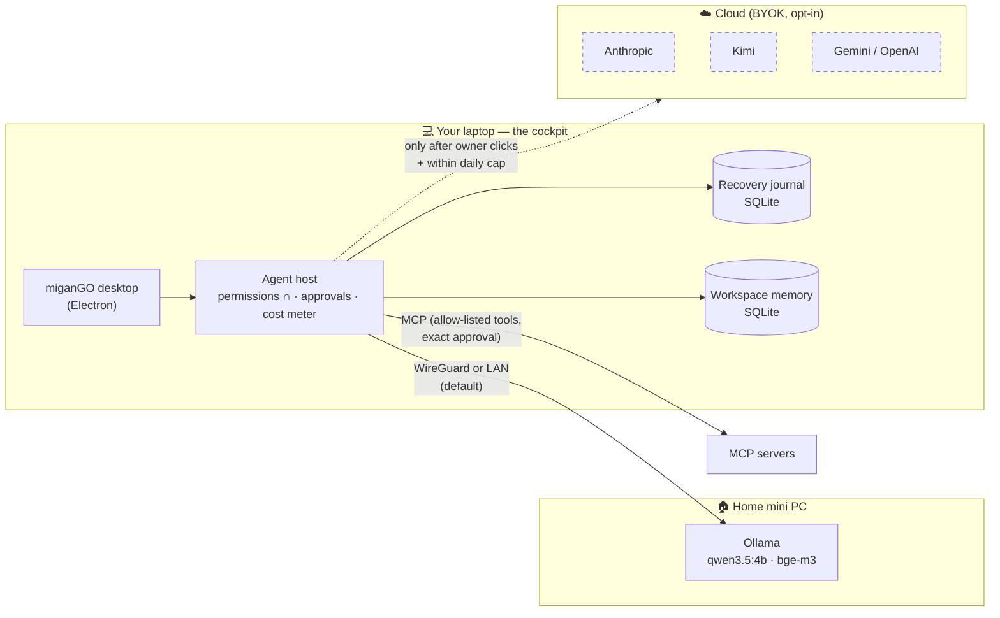
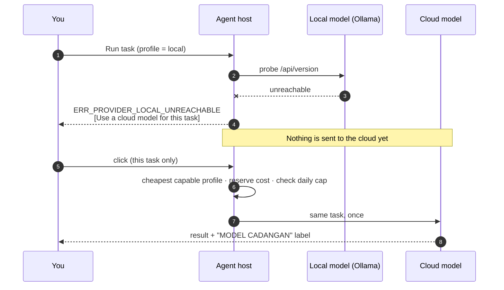

<p align="center">
  
</p>

<p align="center">
  <a href="LICENSE"></a>
  
  
  
  
  
</p>

# miganGO

**A local-first desktop AI agent that runs on the hardware you already own and asks before it spends.**

Most agents assume a fast cloud model and a credit card. miganGO assumes a $200 mini PC in your house,
an owner who wants to approve every risky action, and a hard daily budget per provider.
It routes work to a local model first, never switches to a paid model behind your back,
and keeps a crash journal that **holds** uncertain side effects instead of replaying them.

> **Status — honest version.** miganGO was built by one person with AI pair-programmers over 18 days
> (514 commits). The core is real and tested. It is **Windows-only** today, the UI is **Indonesian-first**
> (English strings are welcome), and the maintainer is now focused elsewhere — this repo is open so
> the community can take it further. See [what is shipped vs planned](#what-works-today).

---

## Why it exists — five things other agents don't combine

| | What miganGO does | Why it matters |
|---|---|---|
| 🏠 **Local-first on cheap CPUs** | Routes to Ollama on a home mini PC (e.g. `qwen3.5:4b`) over WireGuard; cloud is a visible, per-task choice | Your private work never leaves the house by default; marginal cost $0 |
| 🔒 **No silent provider switch** | If the local box is down, the run **stops** and offers "Use a cloud model for this task" — one task, one click | You always know which model touched your data and your wallet |
| 💸 **Hard spend caps** | Per-provider daily USD caps + 2M-token cap, reservations under cross-process locks | A runaway loop can't drain your API balance overnight |
| ✋ **Owner-gated tools** | Exact-args, one-time, 120-second approvals; tool authority = intersection of 5 sets; tiered shell classifier | The model proposes; you dispose |
| 🧯 **Crash-honest recovery** | SQLite journal + Windows Job Objects; uncertain effects are **held for you**, never auto-replayed | No double emails, no double deploys after a crash |

---

## Who it's for — and who it isn't

| ✅ A great fit if you… | ❌ Probably not for you if you… |
|---|---|
| run (or want to run) a **local model** on a laptop or a cheap home box and use the cloud only when it pays off | need the biggest ecosystem and plugins today — use opencode, Claude Code, Codex or OpenClaw |
| have been **surprised by an API bill** and want a hard daily ceiling per provider | are on macOS/Linux and can't help port (Windows-only for now) |
| want an agent that **asks before acting** and can explain exactly why a tool was allowed | want a fully autonomous agent that never asks |
| work with **private data** (clients, finance, health) and must know which model saw it | only need autocomplete inside an IDE — use Cursor or Cline |
| are a **researcher or builder** studying agent safety: approvals, spend control, crash recovery | want a polished, signed installer with support |
| prefer a UI in **Bahasa Indonesia**, or want to help make agents local for non-English users | |

## Why use it — benefits

- **Spend less, predictably.** Local model by default; cloud spend stops at a hard cap per provider
  per day. In our own logs the expensive model cost **$2.65 per 1M tokens** and the local one **$0** —
  see the charts below.
- **Know where your data went.** No silent provider switch: a cloud model only sees a task after you click.
- **Fewer 2 a.m. surprises.** After a crash, uncertain side effects are *held* for review — no double
  sends, no double writes.
- **Explainable permissions.** A tool runs only if five independent layers allow it; approvals are exact
  and expire in 120 s. Easy to audit, easy to reason about.
- **Bring your own keys, keep them local.** Keys live in the Windows credential vault and are never shown
  again.

## Why contribute — benefits for developers

- **A small, readable codebase with real safety engineering** — approvals, spend reservations under
  cross-process locks, a recovery journal, an AppContainer sandbox — the parts most agent repos skip.
- **Tests that mean something.** ~1,480 test cases plus **49 mutation scripts** that delete a safety
  control and prove the test turns red. Your PR lands on a codebase where "green" is earned.
- **Clear, unsolved problems** with visible impact: macOS/Linux sandbox, English UI, RAG, an image route,
  conversation-level privacy taint. Each is a self-contained issue.
- **A portfolio piece that shows judgement**, not just features: cost control, threat modelling and honest
  status reporting are what teams hiring AI engineers look for.
- **Help bring local-first agents to emerging markets** — Indonesian-first UX is a real gap (none of the
  major agents ship one).

## Engineering principles

1. **Red test first.** Every behaviour change starts with a test that fails on `main`.
2. **Mutation-proof safety.** A safety control is only "tested" if removing it makes a test fail.
3. **Honest status words.** `responded` / `needs-validation` / `verification-failed` — never "passed"
   without a verifier.
4. **No silent side effects.** No provider switch, no replay after crash, no approval that outlives its
   arguments.
5. **Measure with your own tool.** The cost charts in this README come from miganGO's own ledger.

Deep dives: **[How it works](docs/HOW-IT-WORKS.md)** (harness, router, brain, every tool, module methods) · **[Architecture & threat model](docs/ARCHITECTURE.md)** · **[Test & trial results](docs/TEST-RESULTS.md)** · **[Comparison](docs/COMPARISON.md)**.

---

## Architecture



### What happens when the local model is unreachable



---

## The math (from the code, not the marketing)

**Tool authority** — a tool is callable only if every layer allows it
(`src/agents/permissions.mjs → effectiveTools`):

$$
T_{\text{effective}} \;=\; T_{\text{owner}} \,\cap\, T_{\text{built-in}} \,\cap\, T_{\text{agent}} \,\cap\, T_{\text{mode}} \,\cap\, T_{\text{parent}},
\qquad T_{\text{ask}} = \{\texttt{list\_files},\ \texttt{read\_file},\ \texttt{search\_files}\}
$$

**Spend gate** — before every call a reservation $r$ is taken under a file lock
(`src/core/cost-meter.mjs`); the call proceeds only if

$$
\text{spent}_{p,\,\text{today}} + r \;\le\; \text{cap}_p,\qquad
\text{cap} = \{\text{anthropic}: \$5,\ \text{kimi}: \$3,\ \text{gemini}: \$3,\ \text{runpod}: \$10\},\quad
\textstyle\sum \text{tokens}_{\text{today}} \le 2\,000\,000
$$

Statuses returned *before* the model runs release the reservation; everything else is billed.

**Context compaction** — no extra model call (`src/agents/compact.mjs`):

$$
\text{compact older turns} \iff \text{bytes}(\text{request}) \;\ge\; 0.7 \times \text{limit}_{\text{provider}}
$$

**Retry** — retryable errors only (`src/core/provider-retry.mjs`):

$$
t_k = \min\!\big(\text{Retry-After},\,30\,\text{s}\big)\ \text{if given, else}\ \ 2^{k}\,\text{s} + U(0,1)\,\text{s},\quad k = 1,2,3
$$

**Approvals** — exact arguments, one use, bound to the (agent, run) pair, expire after **120 s**.

**Evaluation** — plain vs backbone runs compared with bootstrap confidence intervals
(`src/eval/backbone.mjs → bootstrapCI`); "passed" is never claimed from a chat reply — results are
`responded` or `needs-validation` until a verifier says otherwise.

---

## Real numbers from the maintainer's own logs

These come from miganGO's own cost ledger (`%APPDATA%/migan-workbench/costs`) while the maintainer
built and tested it — **not a benchmark**, and they include deliberate failure tests.

<p align="center"></p>

<p align="center"></p>

<details><summary>Table view (same data) + median wall-clock per run</summary>

| Model | Runs | Spend (USD) | Blended $/1M tok | Median run (s) |
|---|---:|---:|---:|---:|
| Claude Opus 5.5 | 149 | 249.11 | 2.65 | 155.1 |
| Claude Sonnet 5.5 | 64 | 25.90 | 1.94 | 24.5 |
| Kimi K3.1 Pro | 26 | 9.55 | 0.67 | 407.5 |
| Claude Haiku 5.5 | 314 | 5.37 | 0.48 | 10.5 |
| Kimi K2.6 | 29 | 1.18 | 0.51 | 18.1 |
| qwen3.5:4b on a home CPU | 31 | 0.00 | 0 | 70.4 |
| qwen3:4b on a home CPU | 9 | 0.00 | 0 | 55.3 |

627 runs, 2026-10-26 → 2026-11-09. Wall-clock includes tool calls and multi-turn work, so it is not a
latency benchmark. The lesson the maintainer took: **the expensive model was mostly used to test the
tool itself** — which is exactly why miganGO defaults to local and caps cloud spend.
</details>

---

## How it compares

Full table with a source on every cell: **[docs/COMPARISON.md](docs/COMPARISON.md)** (checked 2026-11-09).

| | miganGO | opencode | Claude Code | Codex | Hermes Agent | OpenClaw |
|---|:-:|:-:|:-:|:-:|:-:|:-:|
| Open source | ✅ MIT | ✅ MIT | ❌ | ✅ Apache-2.0 | ✅ MIT | ✅ MIT |
| Local model as the **default** route | ✅ | ⚪ supported | ❌ | ❔ | ⚪ supported | ⚪ supported |
| Cloud fallback **asks first**, per task | ✅ | ❔ | ❌ automatic | ❔ | ❌ automatic | ❌ automatic |
| **Hard** per-provider daily spend cap, built in | ✅ | ❌ | ⚠️ estimate, print mode | ⚠️ plan limits | ⚠️ MCP only | ❔ |
| Crash journal that **holds** uncertain effects | ✅ | ❔ | ❔ | ❔ | ❔ | ❔ |
| Private-memory **taint lock** (chat → local only) | 🧪 branch | ❌ | ❌ | ❌ | ❌ | ❌ |
| Bahasa Indonesia UI | ✅ | ❌ | ❔ | ❔ | ❔ | ❌ |
| Cross-platform | ❌ Windows | ✅ | ✅ | ✅ | ✅ | ✅ |
| Ecosystem / stars | 🌱 new | 225k | 155k | 134k | 262k | 394k |

✅ yes · ⚪ supported but not the default · ⚠️ partial · ❌ no / not found · ❔ unverified · 🧪 designed + tested, not merged

---

## What works today

Every row points at code + tests in this repo. **Shipped** = code and tests on `main`.

| Area | Capability | Status |
|---|---|---|
| Providers | BYOK for Anthropic, OpenAI, Kimi, Gemini, RunPod, Ollama; keys in the Windows vault (`core/providers.mjs`, `core/storage.mjs`) | ✅ Shipped |
| Routing | 9 task routes, auto classifier + manual override + per-task picker (`core/model-registry.mjs`, `core/adaptive-routing.mjs`) | ✅ Shipped |
| Fallback | No silent provider switch: an explicit local choice **stops** when the local box is down and offers a one-task "use a cloud model" button; only *Auto* mode moves on, to the cheapest capable profile, labelled (`core/local-fallback.mjs`) | ✅ Shipped |
| Private memory | Optional external brain is **off by default**, redacted before truncation and fenced as data when enabled | ✅ Shipped |
| Spend | Daily caps per provider, 2M-token cap, locked reservations, stale-price warning, prompt-cache metering (`core/cost-meter.mjs`) | ✅ Shipped |
| Tools | Workspace files (hash-guarded edits), tiered shell, SSH, web read/search (DNS-checked), MCP client (`tools/`) | ✅ Shipped |
| Desktop control | Window focus, screenshot, OCR, click/type — only in owner-enabled control mode, each action approved (`core/mode-kendali.mjs`) | ✅ Shipped |
| Browser agent | Separate Chromium: open, snapshot, click, fill; passwords blocked | 🟡 Partial |
| Permissions | 5-set intersection, Ask/Work/Build modes, exact one-time approvals (`agents/permissions.mjs`, `core/approvals.mjs`) | ✅ Shipped |
| Memory | Workspace-scoped SQLite with trust levels; optional external brain over MCP; owner-approved notes (`memory/`) | ✅ Shipped |
| Context | Template compaction at 70 % of limit, hard `fitContext`, project prelude (`agents/compact.mjs`) | ✅ Shipped |
| Agent team | Delegated child agents with budget, preflight and per-child permissions (`agents/delegate.mjs`) | ✅ Shipped |
| Skills | Discovers `.agents` / `.claude` / `.codex` skills, budgeted selection (`agents/skill-router.mjs`) | ✅ Shipped |
| Verification | Post-edit verifier marks runs `verification-failed` (`agents/verifier.mjs`) | ✅ Shipped |
| Recovery | SQLite journal + Job Objects; uncertain effects held for the owner (`recovery/`) | ✅ Shipped |
| Sandbox | Windows AppContainer for candidate/oracle runs (not LPAC/VM) (`sandbox/`) | ✅ Shipped (stated limits) |
| Self-improvement | Fail-first assertion → ≤2 JSON patches → pinned oracle → snapshot activation; protected paths (`improvement/`) | ✅ Shipped |
| Eval | Plain-vs-backbone with bootstrap CI, parity tests, owner gold set (`eval/`) | ✅ Shipped |
| Compare studio | One prompt to ≤4 models side by side, metered (`studio/banding.mjs`) | ✅ Shipped |
| Local bridge | `127.0.0.1` HTTP API + stdio MCP adapter; can never approve shell/SSH/desktop actions (`desktop/local-bridge.mjs`, `bridge/`) | ✅ Shipped |
| RAG | Embedder/retriever/indexer | 📝 Spec only |
| Image route | Adapter for the `visual` route | 📝 Planned |
| Installer | Signed installer, macOS/Linux | 📝 Planned |

**Tests:** 214 test files (~1,480 cases) + 49 mutation scripts that prove safety tests fail when the control is removed.

---

## Quick start (Windows 10/11)

```powershell
git clone https://github.com/fahmiwol/migango-agent && cd miganGO
npm ci
npm start
```

Optional local brain: install [Ollama](https://ollama.com), `ollama pull qwen3.5:4b`, then pick
**Connection → Ollama** in the app. Keys you add are stored in the Windows credential vault and never
shown again.

```powershell
npm test               # unit + integration (node:test)
npm run test:desktop   # Electron UI tests
npm run verify         # evidence seal check
```

---

## Roadmap & good first issues

- 🌍 **English UI strings** (all text already goes through i18n keys)
- 🐧 **macOS / Linux**: replace AppContainer + Job Objects with platform equivalents
- 🖼️ **Image route adapter** (the `visual` route exists, no adapter yet)
- 📚 **RAG module** (`src/rag/` is a spec only)
- 🔐 Conversation-level **privacy taint** (design exists: once private memory enters a chat, that chat is
  locked to local models) — see `docs/`
- 🌐 Owner-only **web allow-list** for `web_read` / `web_search` when untrusted text is in context


## FAQ

**Is a 4B local model really useful?** For routine work — reading files, summarising, small edits,
structured answers — yes; in our own smoke tests `qwen3.5:4b` on a CPU-only mini PC completed the
standard 4-step tool task. For hard reasoning you click once and use a cloud model for that task only.

**Why Windows only?** The sandbox and crash-safe process control use AppContainer and Job Objects.
Porting them is the most valuable contribution you can make.

**Does it send telemetry?** No. Run records, costs and memory stay in `%APPDATA%/migan-workbench`.

**Is it maintained?** It is community-driven. The original author shipped the core and moved on to other
products; PRs are reviewed on a best-effort basis.

## Contributing

PRs welcome — read [CONTRIBUTING.md](CONTRIBUTING.md). Every behaviour change starts with a **red test**;
safety controls get a mutation test that proves the test fails when the control is removed.

## License

[MIT](LICENSE) © Fahmi Ghani · built in Indonesia 🇮🇩
