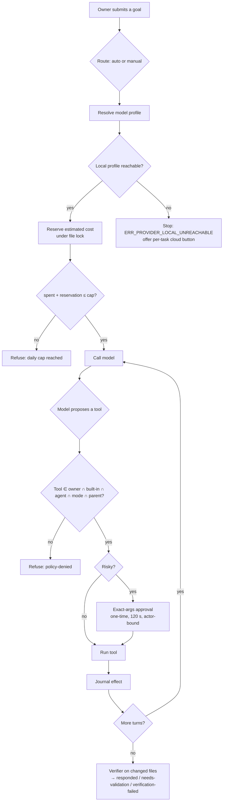

# Architecture & threat model

miganGO is a single Electron app. The **agent host** (Node, main process) owns every decision that
matters — which model, which tool, how much money — and the model only ever *proposes*.

## Module map

| Layer | Folder | Responsibility |
|---|---|---|
| UI | `ui/` | Single-window renderer: goal box, model picker, Ask/Work/Build modes, approval dialog, run list, recovery banner |
| Desktop shell | `src/desktop/` | Electron main, IPC, local HTTP bridge (`127.0.0.1`), browser agent, desktop-control tools |
| Core | `src/core/` | Providers + BYOK vault, routing, local-first fallback, cost meter, approvals, path/workspace rules, shell classifier, retry |
| Agents | `src/agents/` | Agent runtime, permission intersection, delegation (agent team), skill router, context compaction, verifier, brain adapter |
| Tools | `src/tools/` | Tool registry: workspace files, shell/SSH, web, MCP client, OCR, GPU jobs |
| Memory | `src/memory/` | Workspace-scoped SQLite memory with trust levels |
| Recovery | `src/recovery/` | Effect journal, Job Object custody, hold-don't-replay after crash |
| Sandbox | `src/sandbox/` | Windows AppContainer runner for candidate/oracle code |
| Improvement | `src/improvement/` | Fail-first self-improvement with pinned oracle and snapshot activation |
| Eval | `src/eval/`, `evals/` | Plain-vs-backbone benchmark with bootstrap CI, parity tests |
| Bridge | `src/bridge/` | stdio MCP adapter over the local bridge |

## Life of a request

## Threat model

| Asset | Threat | Control | Where it is tested |
|---|---|---|---|
| Your money | Runaway loop or price change drains an API balance | Per-provider daily USD cap + daily token cap; reservations under cross-process locks; stale-price warning | `tests/unit/cost-meter*.test.mjs` + mutation scripts |
| Your data | Agent silently sends private context to a cloud model | No silent provider switch; cloud fallback only after an explicit per-task owner action | `tests/unit/local-fallback.test.mjs` |
| Your files | Prompt-injected model writes outside the workspace | Canonical paths, symlink/junction refusal, outside-root refused **before** approval | `tests/unit/path-sebelum-persetujuan.test.mjs`, `switch-workspace.test.mjs` |
| Your machine | Model runs a destructive shell command | Tiered classifier (unknown ⇒ higher tier), exact one-time approval, 60 s limit, Job Object tree kill | `tests/unit/terminal-bertingkat.test.mjs`, `process-custody.test.mjs` |
| Approvals | Replay or reuse of an approval for different arguments | Approval bound to exact args + (agent, run), single use, 120 s TTL | `tests/unit/approvals*.test.mjs` |
| Local bridge | A web page or another process drives the agent | `127.0.0.1` only, random bearer token, any `Origin` rejected, Host check, 64 KiB cap, cannot approve shell/SSH/desktop | `tests/unit/local-bridge.test.mjs`, `bridge-origin.test.mjs`, `bridge-route-guards.test.mjs` |
| Integrity after crash | Double email / double write after restart | Effect journal; uncertain effects held for the owner, never auto-replayed | `tests/unit/recovery*.test.mjs` |
| Self-modification | Agent patches its own safety code | Protected paths; fail-first assertion; pinned oracle in AppContainer; snapshot activation, never overwrite | `tests/unit/improvement*.test.mjs` |
| Web content | Untrusted page text treated as instructions | Content marked untrusted; DNS-resolved public-address check before fetch | `tests/unit/web-read.test.mjs` |

**Explicit non-goals (documented limits):** approved shell, SSH and MCP tools are trusted and unsandboxed;
the AppContainer sandbox is not LPAC/VM-grade; the desktop-control mode is as powerful as the owner who
enables it.

## Key design decisions

- **Stop, don't switch.** Automatic fallback is convenient and is exactly how private data ends up in the
  wrong place. We trade one click for certainty.
- **Caps in the agent, not in a gateway.** A cap you have to deploy separately is a cap most people never
  set up.
- **Honest status vocabulary.** A chat reply is evidence of a reply, not of correctness.
- **Hold, don't replay.** After a crash the safest action for an uncertain side effect is to ask.
- **Intersection, not union, for permissions.** Adding a layer can only remove power, never add it.
