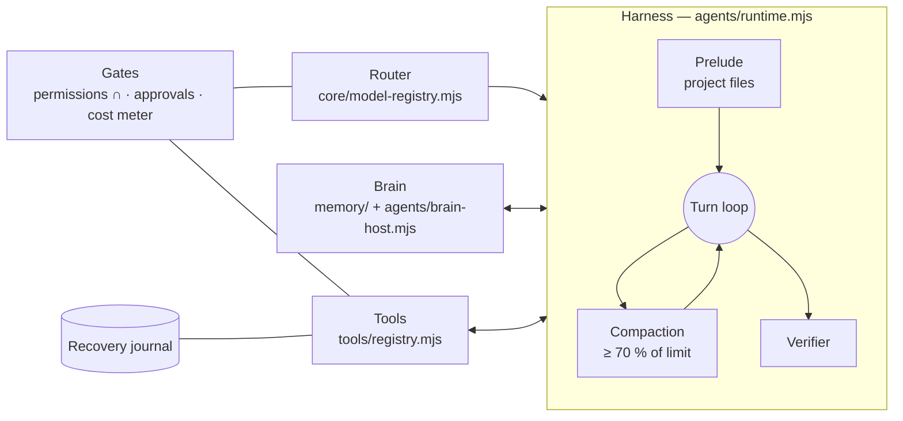

# How miganGO works

A technical tour of the **harness**, the **router**, the **brain**, the **tool set** and the methods each
module uses. File paths are relative to `src/`.

---

## 1. The harness (agent runtime)

`agents/runtime.mjs` runs one **task** as a loop of model turns:

1. **Prelude** (`agents/prelude.mjs`): a small, budgeted set of project files (README, AGENTS.md-style
   rules, the task's workspace map) is prepended so the model starts oriented.
2. **Skill selection** (`agents/skill-router.mjs`): skills discovered in `.agents/`, `.claude/` and
   `.codex/` folders are ranked by metadata first; only the most relevant bodies are loaded, within a token
   budget. Draft skills are never auto-enabled.
3. **Turn**: the model answers or proposes tool calls. Each proposed call goes through the **gates**
   (section 4) before anything runs.
4. **Continuation**: if the model stops on `max_tokens`, the harness continues up to **3** times and
   records each continuation.
5. **Compaction** (`agents/compact.mjs`): when the request reaches **70 %** of the provider's input
   limit, older turns are folded into a fixed-template summary. There is **no extra model call**, so
   compaction is free and deterministic. A hard `fitContext` in `core/router.mjs` is the last line.
6. **Verification** (`agents/verifier.mjs`): after edits, checks run on the changed files. The run ends as
   `responded`, `needs-validation` or `verification-failed`, never "passed" without evidence.

**Agent team** (`agents/delegate.mjs`): a parent can delegate a sub-task to a child agent with its own
budget, a preflight check and a **narrower** permission set (the child's tools are intersected with the
parent's). A council step can require approval of the delegation itself.

**Unattended rounds** (`runflow/putaran.mjs`): a headless runner repeats rounds toward a goal for
scheduled or batch work, with the same gates.

---

## 2. The router

`core/model-registry.mjs` + `core/adaptive-routing.mjs`

**Nine task routes**, each with the capabilities a model must have:

| Route | Requires |
|---|---|
| conversation | text |
| summary | text |
| research | text, tools |
| coding | text, tools, code |
| debugging | text, tools, code |
| planning | text |
| creative | text |
| visual | vision |
| review | text, code |

**Classification** (`classifyTask`): if the owner picked a route, it wins (confidence 1.0). Otherwise
**ordered** regex rules match English and Indonesian keywords. The first match wins (confidence 0.8),
and the fallback is `conversation` (0.5). The order is deliberate: `visual` → `debugging` → `review` →
`planning` → `summary` → `research` → `coding` → `creative`, so "fix the failing build" routes to
debugging, not coding.

**Resolution** (`resolveModel`): picks the owner's profile for that route whose model satisfies the
route's `requires`. A per-task picker (`task-model.mjs`) lets the owner pin a model for one run.

**Local first** (`core/local-fallback.mjs`): before a local run, `probeOllama` checks the endpoint. If it
is unreachable and the owner explicitly chose local, the run **stops** and offers a one-task cloud
button. Only the *Auto* routing mode may move on by itself, and only to the **cheapest capable**
profile, with a visible label.

**Retry** (`core/provider-retry.mjs`): retryable errors back off 2 s, 4 s and 8 s plus up to 1 s of
jitter, or follow the provider's `Retry-After` (capped at 30 s).

---

## 3. The brain (memory)

Three layers, from most to least trusted:

| Layer | Where | Method |
|---|---|---|
| **Owner facts** | `memory/context-store.mjs` | Current facts the owner set override older notes |
| **Workspace memory** | SQLite, scoped by a hash of the workspace's real path | Notes carry a trust level. `memory_search` reads, and `memory_note` *proposes* a note that the owner must approve |
| **External brain** (optional) | Any MCP server registered as `brain` (`agents/brain-host.mjs`) | Called through `mcp_call` under the same permissions and exact approvals. Nothing is written to it implicitly |

Memory never leaves the machine unless a tool the owner approved sends it. The external brain is just
another MCP server, so you can plug in your own knowledge base.

---

## 4. The gates (what makes it safe)

### Permission intersection — `agents/permissions.mjs`

$$
T_{\text{effective}} = T_{\text{owner}} \cap T_{\text{built-in}} \cap T_{\text{agent}} \cap T_{\text{mode}} \cap T_{\text{parent}}
$$

| Mode | Tools allowed |
|---|---|
| **Ask** | `list_files`, `read_file`, `search_files` (read-only) |
| **Work** / **Build** | everything the other four layers allow |

### Approvals — `core/approvals.mjs`

Approvals are exact-argument and one-time, bound to `(agent, run)`, with a **120 s** TTL. Changing one
argument means a new approval.

### Spend — `core/cost-meter.mjs`

A reservation is taken under a cross-process file lock. A call proceeds only if
`spent_today(provider) + reservation ≤ cap(provider)`. The defaults are $5 Anthropic, $3 Kimi,
$3 Gemini, $10 RunPod, and 2,000,000 tokens/day. Statuses returned *before* the model runs release the
reservation. Prices older than 90 days raise a warning.

### Shell classifier — `core/terminal-bertingkat.mjs`

| Tier | Meaning |
|---|---|
| A | read-only |
| B | writes inside the workspace root |
| C | outside the root, network or delete |
| X | always refused |

Anything the classifier can't classify confidently goes **up** a tier, never down.

### Paths — `core/folder-kerja.mjs`

Paths are canonicalised, and symlinks and junctions are refused. A write outside the workspace is
refused **before** the owner is even asked.

---

## 5. Tools

| Group | Tools | Gate |
|---|---|---|
| Workspace | `list_files`, `read_file`, `search_files`, `workspace_info` | read: no approval |
| Workspace edit | `edit_file` (single segment, full-file hash guard), `write_file`, `workspace_mkdir`, `workspace_move` | path rules + approval in Work/Build |
| Terminal | `shell` (60 s, no retry), `ssh` | tier classifier + exact approval |
| Web | `web_read` (public address only, DNS-checked, content untrusted), `web_search`, `feed_read`, `open_url` | untrusted-content handling |
| Browser agent | `browser_open`, `browser_tabs`, `browser_snapshot`, `browser_click`, `browser_type`, `browser_fill`, `browser_scroll`, `browser_screenshot` | separate Chromium; password fields blocked |
| Desktop control | `desktop_windows`, `desktop_focus`, `screen_capture`, `ocr_read`, `input_click`, `input_type`, `input_key` | only in owner-enabled control mode; each input approved; secrets/OTP refused |
| MCP | `mcp_list`, `mcp_call` | server registered + tool allow-listed + exact approval |
| Memory | `memory_search`, `memory_note` | note needs approval |
| GPU jobs | `runpod_endpoints`, `runpod_run`, `runpod_status`, `runpod_stop` | billed against the daily cap; auto-cancel on timeout |
| Team | `delegate` | child budget + narrower permissions |
| Packaging | `draft_package` | produces a reviewable draft, never publishes |
| Discovery | `discover_tools` | lists tool groups without running them |

---

## 6. Reliability modules

| Module | Method |
|---|---|
| **Recovery** (`recovery/`) | A SQLite effect journal records intent → outcome. Windows Job Objects own every child process tree. After a crash, effects with an unknown outcome are **held** for the owner (`periksa-hold`); they are never replayed |
| **Sandbox** (`sandbox/`) | Candidate and oracle code runs in a Windows AppContainer: cap0, read-only grants, resource job, profile cleanup |
| **Self-improvement** (`improvement/`) | 1) a base assertion must **fail**; 2) a maker proposes at most 2 JSON patches; 3) a **pinned oracle** validates them in the sandbox; 4) activation selects a snapshot and never overwrites source. Protected paths cannot be patched |
| **Evaluation** (`eval/`, `evals/`) | Plain-vs-backbone runs with **bootstrap confidence intervals**, parity tests, and a gold set built from real owner tasks |
| **Compare studio** (`studio/banding.mjs`) | Sends one prompt to up to 4 models side by side, all metered |
| **Local bridge** (`desktop/local-bridge.mjs`, `bridge/`) | `POST /v1/call` on `127.0.0.1` with a random bearer token. Rejects any `Origin`, checks Host, caps bodies at 64 KiB, no CORS. A stdio MCP adapter lets other agents drive miganGO, but the bridge can **never** approve shell, SSH or desktop actions |

---

## 7. Tech stack

Electron 45 · Node ≥ 22 (built-in `node:sqlite`) · `@modelcontextprotocol/sdk` · `commonmark` +
`dompurify` for safe Markdown · native helpers in C# / PowerShell (built on install) · tests on
`node:test` (~1,480 cases) plus 49 mutation scripts.
